<div align="center">

# Millennium Signal

### Finds where Millennium Mutual's money is going, and acts on it

*“We’re writing more business than ever and making less money on it. I want to know where the money is going.”* — CFO, Millennium Mutual

**DATA → DETECT → DECIDE → ACT**

</div>

---

Millennium Mutual sells more policies every quarter and keeps less of the premium. The answer is in two raw exports, `policies.csv` and `claims.csv`, but they are messy: duplicate claims, test records, two date formats, premiums stored as text, and five cities spelled twenty ways.

**Millennium Signal cleans the exports, runs three detections, lets people set the thresholds, and turns every hit into a review task with the messages already drafted.** A person makes each final call, and every step is logged.

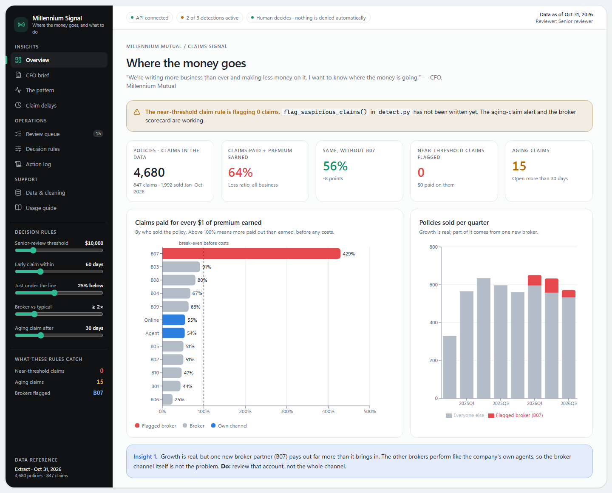

## Results

Data as of Oct 31, 2026.

| Measure | Result |
|---|---|
| Data after cleaning | **4,680 policies · 847 claims** (9 cleaning steps, each logged with its reason) |
| Claims paid ÷ premium earned | **64%** overall · **56%** without broker B07 |
| Broker scorecard | **B07 is the only broker flagged**: 429% loss ratio, 3 of 3 warning signs |
| Aging Claim Alert (N = 30 days) | **15 open claims**, 13 of them with one adjuster team |
| Renewal after a claim | **83%** when the wait was 15–30 days · **45%** past 30 days |

## What it found

**1. One broker, not the broker channel.** B07 started selling in January 2026 and pays out more than four times the premium it earns. The other nine brokers perform like the company's own agents and online channel.

**2. Slow claims cost renewals.** One adjuster team's median settlement time roughly doubled in 2026. Customers who wait more than 30 days renew about half as often as those who wait 15 to 30 days.

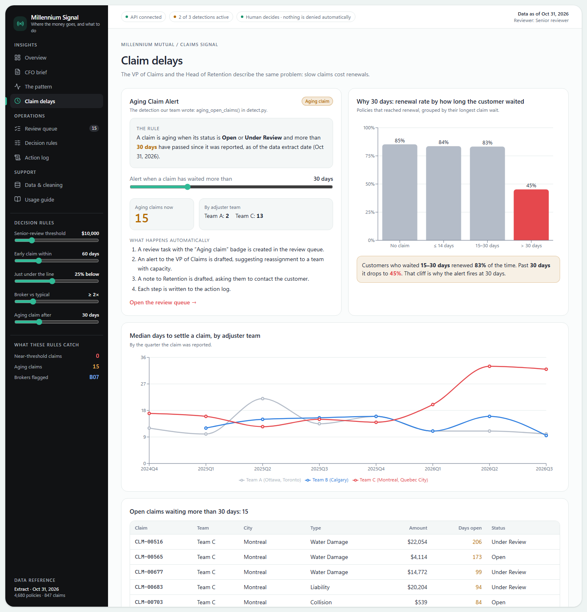

## What it does

| Step | What happens | Where |
|---|---|---|
| **Data** | Cleans the two exports. Every change is recorded with the number of rows and the reason. | Data & cleaning |
| **Detect** | Runs the Aging Claim Alert, the near-threshold claim rule and the broker scorecard. | The pattern · Claim delays |
| **Decide** | People set the thresholds with sliders. Nothing is hard-coded to a broker or a team. | Decision rules |
| **Act** | Each hit becomes a review task with drafted messages. A reviewer confirms or dismisses. | Review queue · Action log |

**The Aging Claim Alert** is the detection our team wrote. A claim is aging when its status is Open or Under Review and more than N days have passed since it was reported (default 30, adjustable from 7 to 90). Each aging claim automatically gets:

1. a review task with an "Aging claim" badge,
2. a drafted alert to the VP of Claims suggesting reassignment to a team with capacity,
3. a drafted note to Retention asking them to contact the customer,
4. a line in the action log for each step.

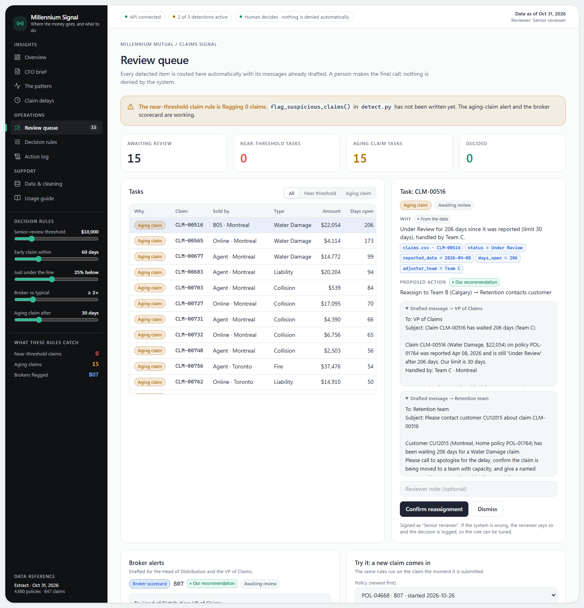

**Evidence and honesty labels.** Every task shows the exact fields the rule used (`status = Under Review`, `days_open = 206`). Statements are tagged **From the data** or **Our recommendation**, so a suggestion is never presented as a fact.

**One-page CFO brief.** The whole answer on a single printable page, with numbers read live from the data.

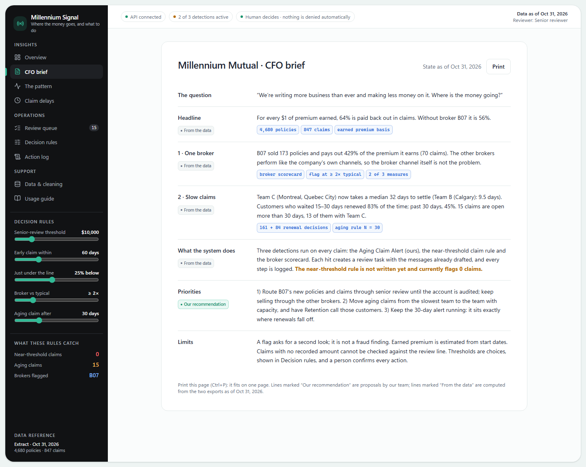

<details>
<summary>More screens</summary>

**The pattern**: claim amounts, the flagged zone and the broker scorecard.
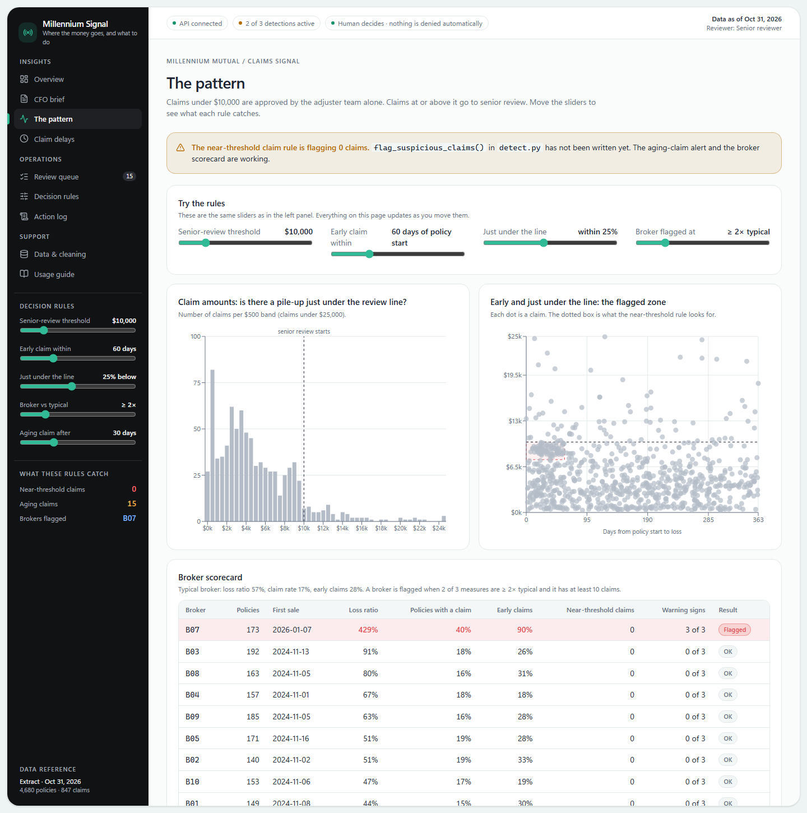

**Decision rules**
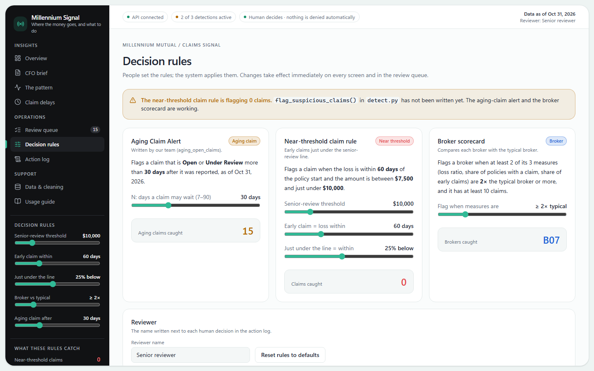

**Action log**
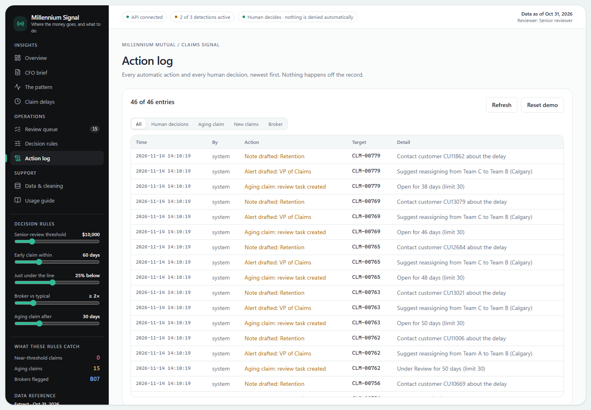

**Usage guide**
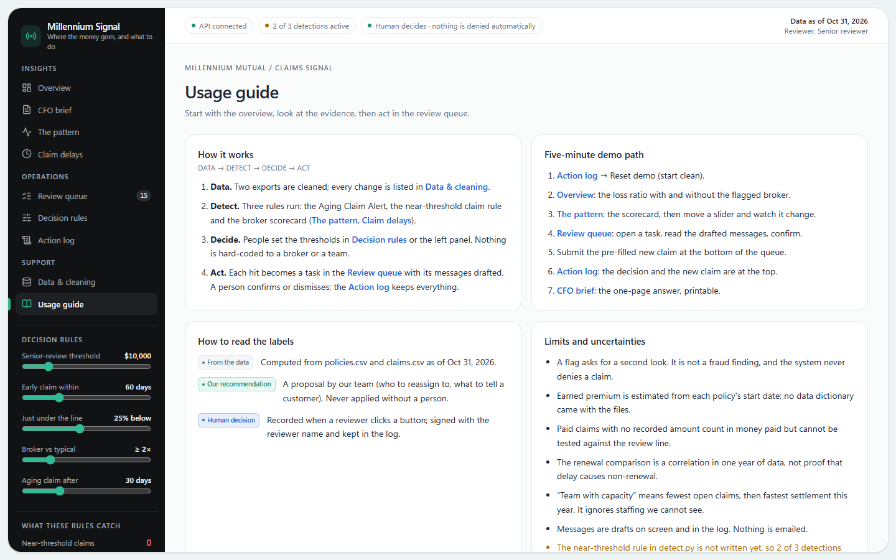

</details>

## Quick start

Requires Python 3.12+ and Node.js 20.9+.

```bash
pip install -r requirements.txt
python -m uvicorn api:app --port 8000
```

In a second terminal:

```bash
cd web
npm install
npm run dev
```

Open http://localhost:3000. Keep `policies.csv` and `claims.csv` in `data/`. The original Streamlit version still runs with `streamlit run app.py`.

## Architecture

### Components

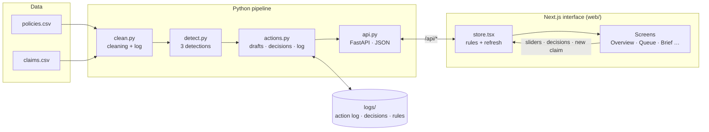

### Data model

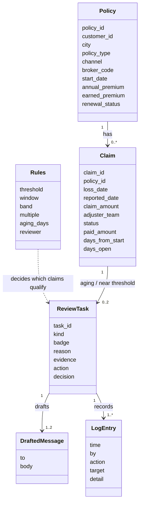

### An aging claim, end to end

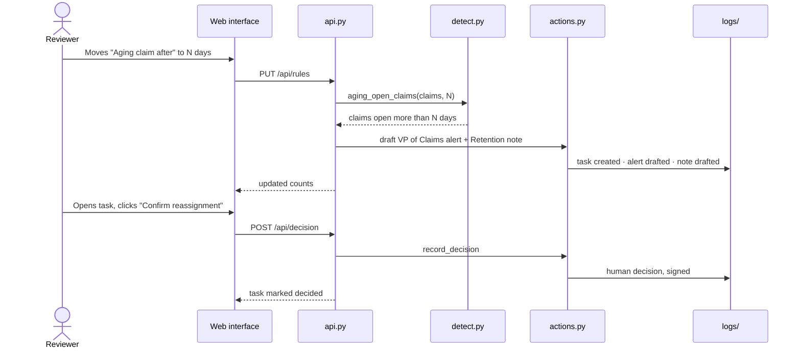

### Life of a review task

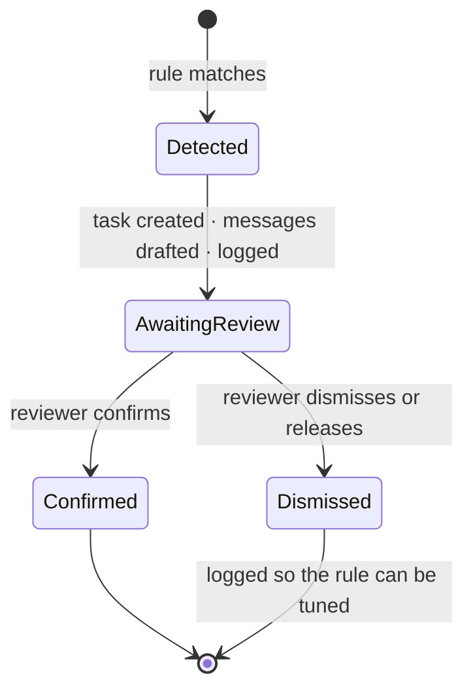

## Project structure

```
data/                 The two raw exports (policies.csv, claims.csv)
clean.py              Loads and cleans the exports; records every change
detect.py             The three detections
actions.py            Drafted messages, human decisions, action log
api.py                FastAPI layer that serves the pipeline as JSON
app.py                Original Streamlit interface (fallback)
web/app/              One folder per screen
web/components/       Navigation shell and shared interface pieces
web/lib/store.tsx     Shared rules state and data fetching
logs/                 Action log, decisions, saved rules (not in git)
docs/screenshots/     Images used in this README
DECISIONS.md          Every build choice and its reason
HANDOFF.md            How to run, demo path, plain-English file guide
```

## Limits and uncertainties

- A flag asks for a second look. It is not a fraud finding, and the system never denies a claim.
- Earned premium is estimated from each policy's start date. No data dictionary came with the files.
- Paid claims with no recorded amount count in money paid but cannot be tested against the review line.
- The renewal comparison is a correlation in one year of data, not proof that delay causes non-renewal.
- "Team with capacity" means fewest open claims, then fastest settlement this year.
- Messages are drafts shown on screen and logged. Nothing is emailed.
- **Current state:** the near-threshold claim rule (`flag_suspicious_claims` in `detect.py`) is not written yet, so 2 of 3 detections are active and the screenshots show 0 near-threshold claims.

## Tools and AI use

- **Stack:** Python, pandas, FastAPI, Next.js 16, React 19, TypeScript, Tailwind CSS 4, Recharts.
- **During development:** Claude Code (Anthropic) helped write the interface and the API layer. The team reviewed the work.
- **In the product:** no AI model runs. Every number comes from the two exports through rules a person can read.

## Team

Arley Ndaribike and team.
